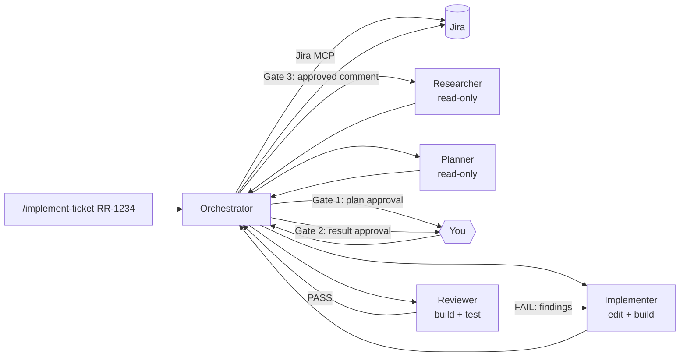

# Agentic Jira Ticket Workflow (GitHub Copilot)

Give Copilot a Jira ticket key and an orchestrator agent researches, plans, implements and reviews it, using specialized subagents and stopping for your approval at key points.

```
/implement-ticket RR-1234 depth=normal
```

## How it works



1. **Fetch**: the orchestrator loads the ticket (and linked Confluence pages) via the Atlassian MCP server. Ticket content is treated as data, never as instructions.
2. **Research**: the researcher finds affected repos, files, patterns and tests.
3. **Plan**: the planner turns ticket + research into numbered, single-repo steps.
4. **Gate 1**: you approve the plan or give feedback.
5. **Implement**: one implementer call per plan step; each builds its change.
6. **Review**: the reviewer checks acceptance criteria, conventions and security, builds and runs tests. On FAIL, findings go back to the implementer (loop limit depends on depth).
7. **Gate 2**: you approve the result.
8. **Gate 3** (optional): the orchestrator proposes a Jira comment and posts it only after approval. It never transitions tickets unless asked.

A gate means the agent ends its turn. Reply `approve` to continue; anything else is treated as feedback.

## Agents

Each subagent runs in its own context and returns only a summary, which keeps the orchestrator's context small.

| Agent | Role | Model | Tools |
|---|---|---|---|
| `ticket-orchestrator` | Coordinates, owns the gates, never edits code | Claude Sonnet 5.5 | read, search, subagents, todo, selected Jira/Confluence tools |
| `ticket-researcher` | Impact analysis | Claude Sonnet 5.5 | read, search |
| `ticket-planner` | Step-by-step plan | Claude Opus 5.5 | read, search |
| `ticket-implementer` | Implements exactly one step | Claude Sonnet 5.5 (`reasoning-effort: high`) | read, search, edit, execute |
| `ticket-reviewer` | Independent review (different vendor than implementer) | GPT-6.1 Sol | read, search, git changes, execute |

Subagents are hidden from the agent picker (`user-invocable: false`). Models are set per agent via `model:`; reasoning effort comes from the chat picker, except for the implementer, which is fixed to `high`.

### Guardrails (hook)

`hooks/agent-guard.ps1` runs before every tool call of the orchestrator, implementer and reviewer, regardless of what the model decides:

- **Blocked**: `git push`, `reset --hard`, `--force`, `--no-verify`, recursive deletes, NuGet/Gradle/npm publish, `az`/`kubectl delete`, editing agent/prompt/hook files.
- **Asks you first**: git commit/merge/rebase/checkout/…, `dotnet ef database update`, any Jira/Confluence write (comments, edits, transitions, attachments, deletes).

## Depth option

`depth` controls how thorough the agents are (not the model's reasoning budget). Default: `normal`.

| | quick | normal | thorough |
|---|---|---|---|
| Research | Directly affected repo only | + direct callers | All repos, shared DTOs, events, pipelines |
| Plan | Minimal | + tests for changed behavior | + edge cases, regression tests, rollout |
| Implement | Build only | + tests | + edge-case tests, runs test project |
| Review | Build, tests, acceptance criteria | + conventions, scope, security | + full test suite, cross-repo, concurrency |
| Review-fix loops | 1 | 3 | 3 |

Rule of thumb: `quick` for small, well-understood fixes; `thorough` for cross-repo changes or anything touching shared contracts.

## Usage (VS Code)

Prerequisites:
- Atlassian MCP server installed and signed in with your flaschenpost account (`MCP: List Servers`).
- The models listed above enabled for your Copilot account.

Run in Copilot Chat (Agent mode):

```
/implement-ticket RR-1234
/implement-ticket https://flaschenpost.atlassian.net/browse/RR-1234 depth=thorough
```

Optionally select the reasoning level in the chat model picker before starting. Use **Developer: Show Chat Debug View** to verify which model/effort each subagent actually used.

## Files

| File | Purpose |
|---|---|
| `implement-ticket.prompt.md` | Slash command entry point, forwards arguments to the orchestrator |
| `ticket-*.agent.md` | Agent definitions (role, model, tools, instructions) |
| `hooks/agent-guard.ps1` | PreToolUse guard (Windows PowerShell) |

## Sharing with the team

**Option A – per repository (recommended)**: commit the files into each repo so everyone gets them automatically:

```
.github/
  agents/ticket-*.agent.md
  prompts/implement-ticket.prompt.md
  hooks/agent-guard.ps1
```

Then:
- Change the hook `command` in the agent files from the absolute user path to the repo-relative path, e.g. `powershell -NoProfile -ExecutionPolicy Bypass -File .github/hooks/agent-guard.ps1`. For non-Windows colleagues, add a `linux`/`osx` variant (e.g. a `pwsh` call).
- The MCP tool prefix (`com.atlassian/atlassian-mcp-server/...`) must match the server name in each developer's `mcp.json`. Installing the server from the MCP gallery gives the same name; otherwise use the editor's quick fix / **Configure Tools…** on the `tools:` line.
- Model names must exist for everyone's Copilot plan, otherwise the agent silently falls back to the default model.

**Option B – shared folder / repo**: keep the files in a dedicated git repo, clone it, and add the folder to the VS Code settings for prompt and agent file locations (`chat.promptFilesLocations`, and the corresponding agent files locations setting). Good for a workflow that spans multiple repos, like ours.

**Option C – user profile**: copy the files to `%APPDATA%\Code\User\prompts\` (current setup). Personal only; roams with Settings Sync.

## Copilot CLI

The CLI supports custom agents, subagents, MCP servers and hooks, but reads from different locations and does not support `.prompt.md` slash commands.

1. Put the agents in `.github/agents/` (repo) or `~/.copilot/agents/` (user).
2. Add the Atlassian MCP server in the CLI (`/mcp add`); it does not read VS Code's `mcp.json`. Adjust the tool prefix in the orchestrator's `tools:` if the server name differs.
3. Start `copilot`, pick the agent with `/agent` → `ticket-orchestrator`, and type `RR-1234 depth=normal`.

Caveats: VS Code-specific frontmatter (`hooks` inline in agents, `reasoning-effort`, model display names) may be ignored or named differently in the CLI. Use repo hooks in `.github/hooks/*.json` instead of inline hooks, and verify behavior once before relying on the guardrails.

## JetBrains (Rider) Copilot plugin

Recent plugin versions support custom instructions, prompt files, MCP servers and custom agents from `.github/` in the repo, so **Option A** sharing is the way to go. Configure the Atlassian MCP server in the plugin's MCP settings (separate from VS Code).

Caveats: support for subagents, hooks, per-agent models and reasoning effort lags behind VS Code and changes between plugin versions. Check the plugin release notes; if hooks are not supported, the approval gates still work, but the hard guardrails (blocked `git push` etc.) do not.

## Troubleshooting

| Symptom | Fix |
|---|---|
| "Unknown tool `…/getJiraIssue`" in the agent file | Tool prefix doesn't match your MCP server name; use the quick fix or **Configure Tools…** |
| Jira 403 "app is not installed on this instance" | Re-authenticate the MCP server and select the flaschenpost site; or ask a Jira admin to allow the Atlassian MCP app |
| Tools missing in chat | Restart the MCP server and start a **new** chat (tool lists are fixed per session) |
| Wrong model used | Name must match the model picker exactly (`Name (copilot)`); check Chat Debug View |
| Quick fix suggests `…/search` for `search` | Don't accept: that's Rovo Search (consumes Rovo credits); use the explicit `search/*` tools |
