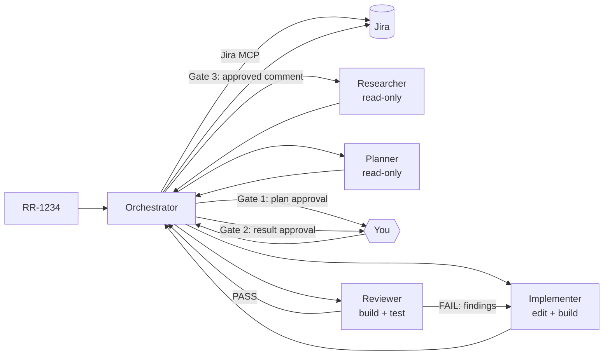

# Agentic Jira Ticket Workflow (GitHub Copilot)

Give Copilot a Jira ticket key and an orchestrator agent researches, plans, implements and reviews it, using specialized subagents and stopping for your approval at key points.

Packaged as an [Agent Plugin](https://code.visualstudio.com/docs/agents/reference/agent-plugin-reference) for the **Copilot harness** (shared by VS Code, Copilot CLI and the Copilot app). The older Local harness is not supported.

Select **ticket-orchestrator** in the agent picker and send:

```
RR-1234 depth=normal
```

## How it works



1. **Fetch**: the orchestrator loads the ticket (and linked Confluence pages) via the Atlassian MCP server. Ticket content is treated as data, never as instructions.
2. **Research**: the researcher finds affected repos, files, patterns and tests, and returns the key signatures/excerpts so the planner doesn't re-read them.
3. **Plan**: the planner turns ticket + research into numbered steps, grouped by repo.
4. **Gate 1**: you approve the plan or give feedback.
5. **Implement**: one implementer call per repo, covering all of that repo's steps; it builds its changes.
6. **Review**: the reviewer checks acceptance criteria, conventions and security, builds and runs tests. On FAIL, findings go back to the implementer (loop limit depends on depth).
7. **Gate 2**: you approve the result.
8. **Gate 3** (optional): the orchestrator proposes a Jira comment and posts it only after approval. It never transitions tickets unless asked.

A gate means the agent ends its turn. Reply `approve` to continue; anything else is treated as feedback.

## Agents

Each subagent runs in its own context and returns only a summary, which keeps the orchestrator's context small.

| Agent | Role | Model (fallback) | Tools |
|---|---|---|---|
| `ticket-orchestrator` | Coordinates, owns the gates, never edits code | `claude-sonnet-5.5` (`claude-sonnet-5`) | read, search, agent, todo, selected Jira/Confluence tools |
| `ticket-researcher` | Impact analysis | `claude-haiku-5.5` (`gpt-6-luna`) | read, search |
| `ticket-planner` | Plan, grouped by repo | `claude-opus-5.5` (`gpt-6-astra`) | read, search |
| `ticket-implementer` | Implements all steps for one repo | `claude-sonnet-5.5` (`claude-sonnet-5`) | read, search, edit, execute |
| `ticket-reviewer` | Independent review (different vendor than implementer) | `gpt-6.1-sol` (`gpt-6-sol`) | read, search, execute |

Subagents are hidden from the agent picker (`user-invocable: false`); the orchestrator can't be started as a subagent (`disable-model-invocation: true`), because its gates need you. The Copilot harness has no `agents:` allowlist, so the orchestrator's instructions restrict delegation to the four ticket agents.

The Copilot harness can't limit a subagent to one caller either. `disable-model-invocation: true` on the workers would block the orchestrator too (the Local harness's `agents:` exception doesn't exist there). Instead, the worker descriptions, which every agent sees when choosing a subagent, say they're orchestrator-only. This is guidance, not enforcement: the default agent can still call them if you ask it to explicitly.

Models use runtime IDs. VS Code reads `model:` (one model); Copilot CLI reads `models:` (first available one is used, so the fallback only applies there). Reasoning effort is the model default for every agent.

CLI-specific fields, ignored by VS Code:
- `strict-tools-list: true` on the orchestrator, researcher and planner, so the CLI doesn't add its default tools to the read-only agents.
- Subagents don't get the repo's AGENTS.md automatically in the CLI. The implementer and reviewer therefore read AGENTS.md and `.github/copilot-instructions.md` of the target repo themselves, which also works in multi-repo workspaces.

### Cost design

Prices per 1M tokens (input / cached input / cache write / output), from [Models and pricing](https://docs.github.com/en/copilot/reference/copilot-billing/models-and-pricing):

| Model | Used by | Price |
|---|---|---|
| Claude Haiku 5.5 (≤ 100K input) | researcher | $0.10 / $0.01 / $0.125 / $0.50 |
| Claude Sonnet 5.5 | orchestrator, implementer | $2 / $0.10 / $2.50 / $10 |
| GPT-6.1 Sol | reviewer | $2 / $0.10 / $2.50 / $10 |
| Claude Opus 5.5 | planner | $4 / $0.20 / $5 / $20 |

- The search-heavy researcher runs on the cheapest model. It reads line ranges rather than whole files, because Haiku 5.5 costs 5× more above 100K input tokens.
- The planner builds on the research excerpts instead of repeating the research at Opus prices.
- One implementer call per repo instead of per step means fewer fresh contexts. Each fresh subagent writes its whole prefix to the cache again (cache write = 25× cached read).
- No `reasoning-effort: high`: output and thinking tokens are the most expensive part of the bill.

### Guardrails (hook)

`scripts/agent-guard.ps1` is an agent-scoped `preToolUse` hook on the orchestrator, implementer and reviewer (the researcher and planner have no edit or shell tools):

- **Blocked**: `git push` (also `git -C … push`), `reset --hard`, `clean -f`, `branch -d/-D`, `--force`, `--no-verify`, recursive deletes (`rm -rf`, `ri -r`, `rd /s`, `… -Recurse | Remove-Item`), NuGet/Gradle/npm publish, `az`/`kubectl delete`, `ef database drop`, `Invoke-Expression`, encoded PowerShell commands, editing agent/skill/plugin/hook files.
- **Asks you first**: git commit/merge/rebase/checkout/switch/stash/tag/cherry-pick/revert/restore, `dotnet ef database update`, any Jira/Confluence write (comments, edits, transitions, attachments, deletes).
- **Fails closed**: malformed input or a payload without `toolName` exits non-zero, which the Copilot harness treats as deny. A **timeout** (15 s) fails open.

This is defense in depth, not a security boundary: regex deny-lists can be bypassed, and `ask` doesn't pause unattended (Autopilot) sessions. The real controls are server-side branch protection and the Copilot harness sandbox and permission settings.

## Depth option

`depth` controls how thorough the agents are (not the model's reasoning budget). Default: `normal`.

| | quick | normal | thorough |
|---|---|---|---|
| Research | Directly affected repo only | + direct callers | All repos, shared DTOs, events, pipelines |
| Plan | Minimal | + tests for changed behavior | + edge cases, regression tests, rollout |
| Implement | Build only | + tests | + edge-case tests, runs test project |
| Review | Build, tests, acceptance criteria | + conventions, scope, security | + full test suite, cross-repo, concurrency |
| Review-fix loops | 1 | 3 | 3 |

Rule of thumb: `quick` for small, well-understood fixes; `thorough` for cross-repo changes or anything touching shared contracts.

## Installation

Prerequisites:
- Atlassian MCP server **`Atlassian Rovo MCP Server`** in `~/.copilot/mcp-config.json`, signed in with your flaschenpost account. The orchestrator's `tools:` reference this server name.
- The models above enabled for your Copilot plan (Business/Enterprise: check the org model policy).
- `chat.plugins.enabled` set to `true`.

### VS Code

1. **Chat: Install Plugin from Source** → paste the repo URL (`https://github.com/MarlinCollmoorFP/copilot-ticket-workflow`). VS Code clones and installs it; no manual clone needed.
2. **Chat: Open Customizations** → **Plugins**: confirm `ticket-workflow` is enabled and the five agents are listed.
3. Updates: **Check for and Apply Updates** (refresh icon) under Plugins, or **Chat: Update Plugins**.

Contributing to the plugin? Clone the repo and register the clone instead, so your edits take effect without reinstalling (user `settings.json`):

```jsonc
"chat.pluginLocations": {
    "C:\\Repos\\copilot-ticket-workflow": true
}
```

### Copilot CLI

1. Add the Atlassian MCP server with exactly this name (the CLI opens the OAuth sign-in on first use):

   ```powershell
   copilot mcp add --transport http "Atlassian Rovo MCP Server" https://mcp.atlassian.com/v1/mcp
   ```

2. Install the plugin: `copilot plugin install MarlinCollmoorFP/copilot-ticket-workflow` (or a Git URL, or a local path for development).
3. Start it in the repo folder: `copilot --agent ticket-orchestrator`, then send `RR-1234 depth=normal`. Inside a session: `/agent` → `ticket-orchestrator`.
4. Costs: `/usage` shows tokens and AI credits per model, `/tasks` the running subagents.

`copilot plugin list` and `/env` show whether the plugin, agents and hooks were loaded.

### Copilot app

The app installs plugins only from marketplaces, so this repo is also a one-plugin marketplace (`.github/plugin/marketplace.json`, name `copilot-ticket-workflow`):

1. **Customize** → marketplace settings control next to the marketplace dropdown → add the repo (`MarlinCollmoorFP/copilot-ticket-workflow` or its Git URL). The repo must be pushed; you need read access and must be signed in to GitHub in the app.
2. Search **Browse** for `ticket-workflow` → **Install**.
3. Check **Customize** → **Installed** that it's enabled, then pick **ticket-orchestrator** in the agent picker.

Keep `version` in `marketplace.json` in sync with `plugin.json`.

### JetBrains (Rider)

Not supported: JetBrains IDEs can't install agent plugins and don't run hooks (no guardrails). Use the Copilot CLI in Rider's terminal instead.

## Usage

1. Select **ticket-orchestrator** in the agent picker.
2. Send the ticket key and optional depth:

   ```
   RR-1234
   https://flaschenpost.atlassian.net/browse/RR-1234 depth=thorough
   ```

## Verify after install or changes

Editor validation doesn't prove that models, tools or hooks are applied at runtime. Check once in a disposable session:

1. **Agent Debug Logs**: each subagent uses its configured model, and the orchestrator only delegates to the four ticket agents.
2. **Tools**: the orchestrator can call `getJiraIssue`. If not, fix the server name in its `tools:` using the editor completions.
3. **Hook**: the debug log shows an `agent-guard` `preToolUse` run for the orchestrator's first tool call (e.g. `getJiraIssue`). If *every* tool call is denied, `${PLUGIN_ROOT}` wasn't expanded in the hook command; check the hook error in the debug log.
4. **Script directly** (no agent involved):

   ```powershell
   '{"toolName":"powershell","toolArgs":{"command":"git -C x push"}}' |
     powershell -NoProfile -ExecutionPolicy Bypass -File scripts/agent-guard.ps1
   ```

   Expected: a `deny` decision and exit code 0. Malformed input (e.g. `not-json`) must exit non-zero.

## Measuring cost

Don't assume the subagent setup is cheaper. Run the same 2–3 tickets with:
- the built-in agent with `/plan`,
- this workflow,
- Copilot Fusion,

and compare AI credits, tokens, cache hit rate and result quality. Use the Agent Debug Logs summary, the **Cache Explorer** and the `chat.subagents.showCreditUsage` setting.

## Files

| File | Purpose |
|---|---|
| `plugin.json` | Agent Plugins 1.0 manifest |
| `com.github.copilot/agents/ticket-*.agent.md` | Agent definitions (role, model, tools, scoped hooks, instructions) |
| `scripts/agent-guard.ps1` | `preToolUse` guard (Windows PowerShell 5.1 or `pwsh`) |

## Sharing with the team

Publish the repo (e.g. in the company GitHub org) and let colleagues install it as a plugin from its Git URL, or add it to a company plugin marketplace and enable it via `.github/copilot/settings.json` (`extraKnownMarketplaces`, `enabledPlugins`). Each developer needs the same MCP server name and the models enabled.

## Troubleshooting

| Symptom | Fix |
|---|---|
| Agents don't appear | Session Target isn't Copilot, `chat.plugins.enabled` is off, or the plugin is disabled under **Customizations → Plugins** |
| Unknown tool `Atlassian Rovo MCP Server/…` | Server name differs on your machine; pick the tools via completions on the `tools:` line |
| Jira 403 "app is not installed on this instance" | Re-authenticate the MCP server and select the flaschenpost site; or ask a Jira admin to allow the Atlassian MCP app |
| Tools missing in chat | Restart the MCP server and start a **new** chat (tool lists are fixed per session) |
| Wrong model used | Model ID unknown or not enabled for your plan; check the Agent Debug Logs and the IDs offered by completions on the `model:` line |
| Every tool call of an agent is denied | Hook script not found or failing (fail-closed); see "Verify" step 3 |
| Used in a Local harness session | Not supported: Local sends a different hook payload, so the guard denies every call |
